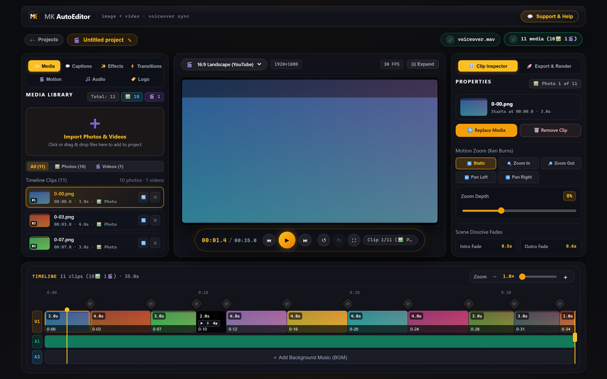
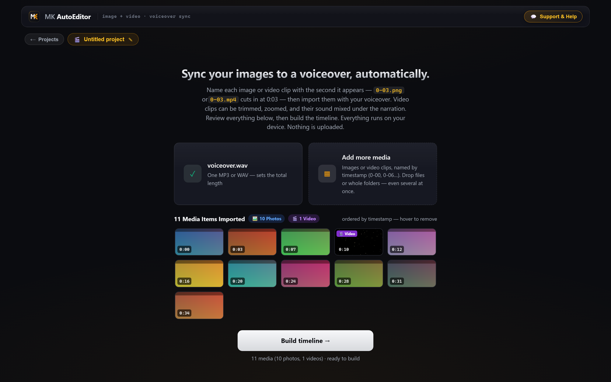
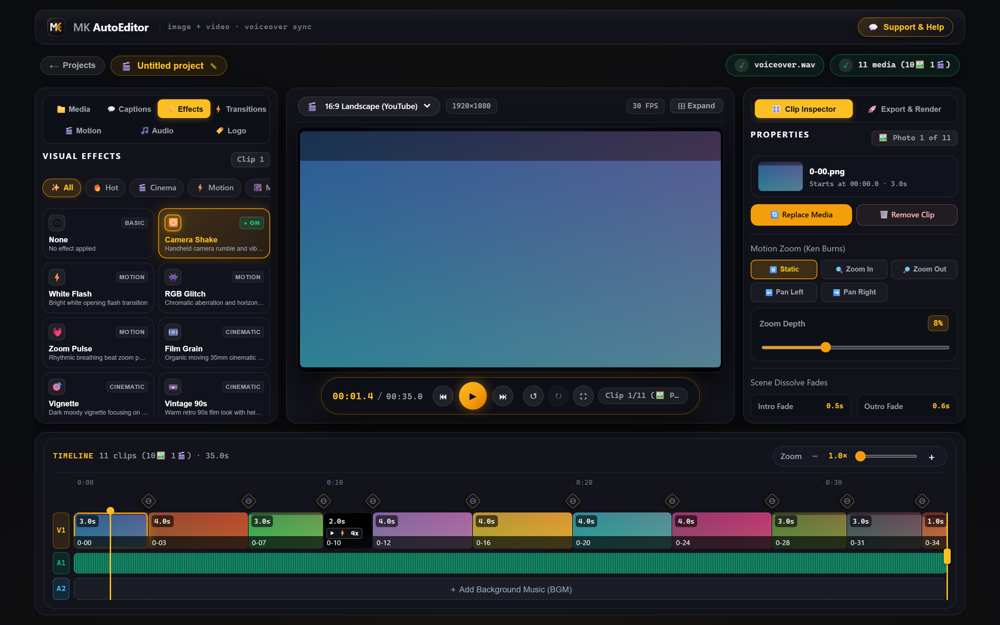

# MK AutoEditor V2 — Automated Timeline & Video Assembler

<div align="center">



**Next-Gen Web Video Assembler for AI Storytellers, Creators & Faceless Content**

[](https://nextjs.org/)
[](https://developer.mozilla.org/en-US/docs/Web/API/WebCodecs_API)
[](https://ffmpeg.org/)
[](https://vitest.dev/)
[](LICENSE)

</div>

---

## 🎬 Overview

**MK AutoEditor V2** is an ultra-fast, professional video assembly studio built for creators producing storytelling videos, finance/documentary content, YouTube videos, and Reels.

Simply drop your **Voiceover Audio** and **Timestamped Images / Video Clips** (e.g., `0-00.jpg`, `0-04.mp4`, `0-15.jpg`). AutoEditor automatically detects all timecodes, aligns the entire timeline, calculates durations, applies cinema transitions with synchronized SFX, generates dynamic captions, and exports a high-definition MP4.

---

## ✨ Live Studio Showcase

### 1. Automated Media Import & Pre-Build Tray
> Intelligently detects and separates **Photos & Videos** with real-time counters (`Total Media`, `🖼️ Photos`, `🎬 Videos`) and ordering by audio timecodes.

<div align="center">
  
</div>

---

### 2. Pro Timeline Studio & Media Hub
> Full multi-track timeline supporting 100+ media clips with instant timecode snapping, waveform preview, transition markers, and dedicated Media Library filters (`All`, `🖼️ Photos`, `🎬 Videos`).

<div align="center">
  
</div>

---

### 3. Cinematic Visual Effects & Transitions Studio
> 12+ real-time canvas visual effects (Golden Dust, Film Grain, Camera Shake, RGB Glitch) plus dynamic Transitions with procedural Whoosh sound effects.

<div align="center">
  
</div>

---

## 🚀 Key Features

* **⚡ Timestamp-Driven Auto Assembly**:
  - Automatically parses file names like `0-00.jpg`, `#0-04.mp4`, `1-20_scene.png`.
  - Zero manual dragging: each media clip automatically stretches to the next cut with pixel-perfect alignment.
* **🖼️ + 🎬 Photos & Videos Combined Engine**:
  - Seamlessly mixes still photos and video clips on the same timeline.
  - Dedicated Media Hub with instant filters (`All`, `🖼️ Photos`, `🎬 Videos`).
  - Auto Speed-to-Fit for video clips to match timeline slots perfectly.
* **✨ Cinematic Transitions & Smart SFX**:
  - Smooth Crossfade, Dip to Black, Slide Left/Right, Wipe, Zoom In/Out.
  - Integrated procedural audio synthesis generating realistic whoosh/swoosh SFX aligned to cut points.
* **💬 Dynamic Styled Subtitles & Captions**:
  - Auto-wraps narration cues with popular fonts (Inter, Montserrat, Oswald, Cinzel).
  - Customizable colors, outlines, stroke, background box, font scaling, and positions (top, center, bottom).
* **🎨 12+ Live Canvas GPU Effects**:
  - Golden Dust particle overlay, 35mm Film Grain, Handheld Camera Shake, RGB Glitch, Vignette, Sepia, and more.
* **🛡️ Dual-Engine Fast Exporting**:
  - **Client-Side Hardware WebCodecs**: Render high-speed 1080p / 720p directly in browser without server upload.
  - **FFmpeg Node.js Render Backend**: Production-grade local / server rendering for complex compositions.

---

## 🛠️ Getting Started

### Prerequisites
- Node.js 18.x or higher
- Modern Chromium browser (Google Chrome, Edge, Brave) for WebCodecs hardware acceleration

### Installation

```bash
# 1. Clone repository
git clone https://github.com/mohdkhan837218-spec/mk-autoeditorV2.git
cd mk-autoeditorV2

# 2. Install dependencies
npm install

# 3. Run development server
npm run dev
```

Open [http://localhost:3000](http://localhost:3000) in your browser.

### Running Tests

```bash
# Run Vitest suite (all 88 tests)
npm test
```

### Production Build

```bash
npm run build
npm start
```

---

## 📂 File Naming Rules for Creators

AutoEditor accepts files named by their start time:

| File Name Example | Parsed Start Time | Action |
|---|---|---|
| `0-00.jpg` | `00:00.0` | Starts at video beginning |
| `0-05.mp4` | `00:05.0` | Starts at 5 seconds (previous clip lasts 5s) |
| `0-12_scene.jpg` | `00:12.0` | Starts at 12 seconds |
| `#1-05.mp4` | `01:05.0` | Starts at 1 min 05 sec (65 seconds) |

---

## 🤝 Support & Community

- **Telegram Support**: [@Mohdashraff18](https://t.me/Mohdashraff18)
- **WhatsApp Updates**: [Join MK Channel](https://whatsapp.com/channel/0029VbDteqXIN9ivtJxB4Q3E)
- **Built by**: Mohd Khan

---

<div align="center">
  <sub>AutoEditor V2 — Designed for speed, precision, and visual storytelling.</sub>
</div>
